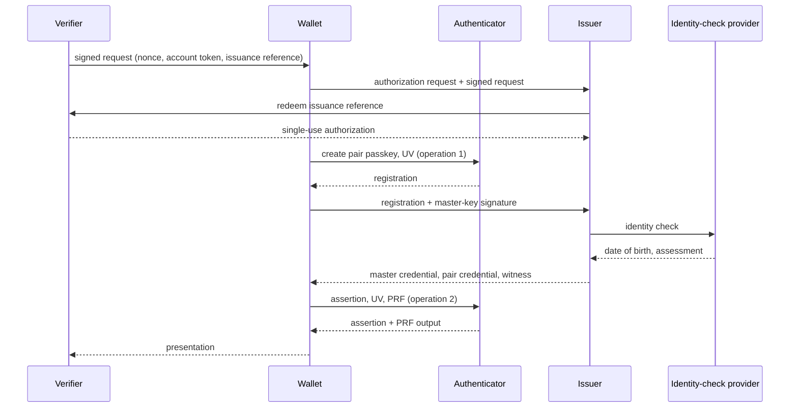
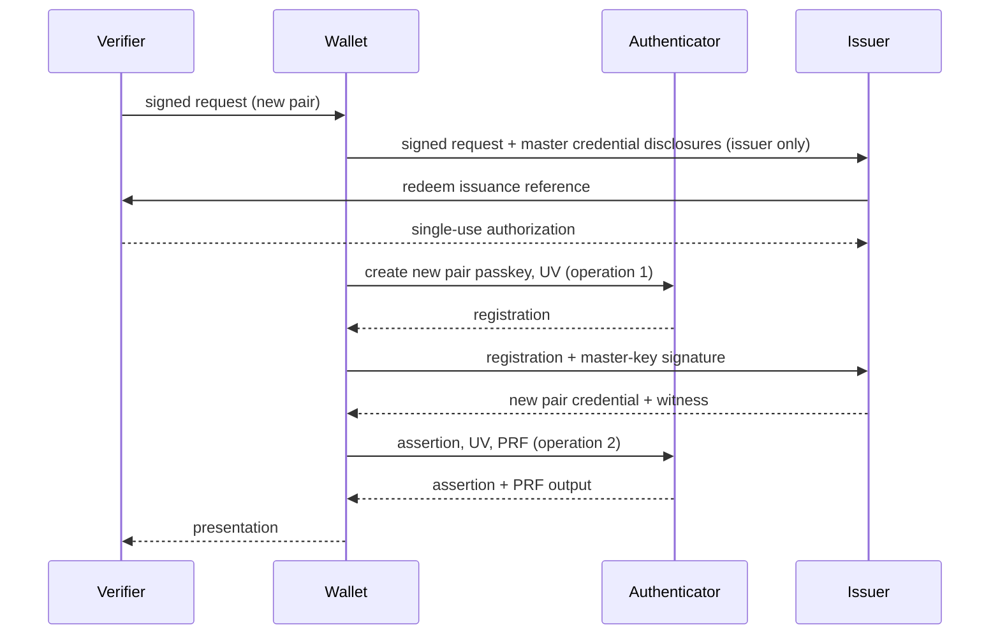
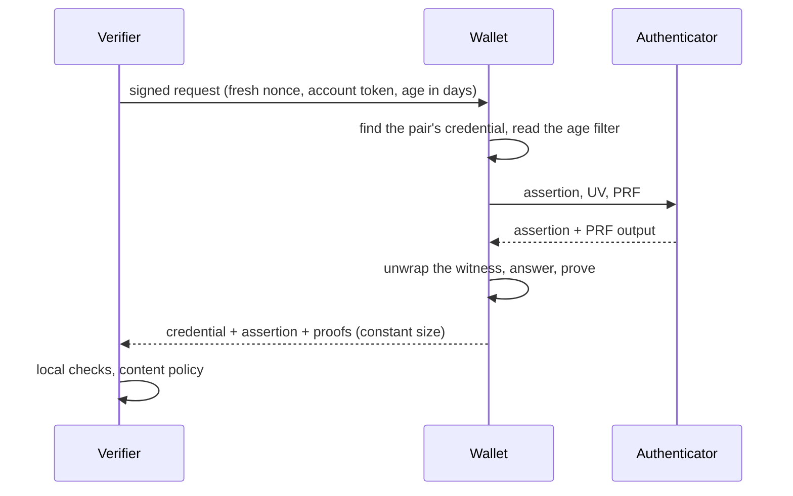

# The age-proof protocol

This document is the contract that vc-proofs implements: the parties, their keys and
credentials, the objects they exchange, and what each party checks. The threats and the
trust model are in [threat-model.md](threat-model.md); the functions that an
application calls at each step are in [integration.md](integration.md).

The words **must**, **must not**, **should** and **may** state requirements of this
project, not of the OpenID standards. A JSON example below is illustrative: it is not a
registered OpenID4VCI or OpenID4VP field unless the text says so. Host names are
examples.

What other documents decide is only named here, with a link to the issue that owns it:
the cryptographic suite (#8), the age proof (#7) and the credential profile with its
encodings (#9).

## Purpose and scope

A **verifier**, for example a platform that shows some content only to viewers above an
age, learns that the person in front of it is old enough, and nothing more: the date of
birth stays with its holder. The proof is cheap enough to be asked each time restricted
content is about to show.

The design rests on:

- one identity check, whose result the holder keeps in a **master credential** and
  reuses for every later verifier;
- an **issuer that keeps no record** of holders, credentials, dates of birth or keys;
- **one credential per (verifier, verifier-local account) pair**, issued when that pair
  first asks, certifying a commitment to the date of birth, and unlinkable to the
  credentials of other pairs;
- OpenID4VCI for issuance and OpenID4VP for requests and presentations, with a profile
  for zero-knowledge age predicates;
- WebAuthn passkeys under the wallet's RP ID for the human ceremony at each issuance and
  each presentation, and their PRF extension to encrypt secrets at rest;
- **no request to the issuer, or to any server of the wallet's provider, during a routine
  presentation.**

vc-proofs provides the helpers of the three sides: the **issuer**, the **wallet** and the
**verifier**. It does not cover the verifier's own enrolment and login of its users, the
wallet's user interface and storage, or how any party is deployed.

## Design invariants

### Stateless issuer

The issuer must not keep any persistent record of enrolments, master credentials, dates
of birth, authenticator keys or pair credentials. It may keep short-lived state for
nonces and transactions. Stateless also means no logs and no metrics that hold personal
data. The library itself has no storage, no logs and no I/O: any state a caller must
keep is handed back to it.

### Presentation without the issuer

Once a pair credential is issued, the verifier checks every presentation locally: the
credential, its own challenge, the WebAuthn assertion and the proofs. The routine
presentation path must not include any call for authorization, revocation, entitlement
or verification to the issuer or to any server of the wallet's provider; the wallet's
code may be served or cached from its own site. The issuer is contacted at each
issuance, and nowhere else.

### One issuance per request

A credential is issued only for the pair that is asking now: no batch, no pool, no
credential made in advance.

### Unlinkable pairs

Each pair has its own credential, its own blinding factor, salts and presentation key.
The wallet uses a credential only for the pair it was issued to (see
[Pair-binding failure](threat-model.md#pair-binding-failure)).

### Authenticator operations

Every issuance takes one authenticator operation, the creation of the new pair's
passkey; every presentation takes one, an assertion by that passkey. The first path of a
new wallet (identity check, issuance, first presentation) therefore takes two, and every
later presentation one. Each operation requires user verification. The issuer and the
verifier check the UP and UV flags themselves.

### Every request gets a proof

Every valid request gets a proof, whose answer is either "old enough" or "uncertain".
There is no "too young": the answer must not change on the holder's birthday (see
[Age proof and answer](#age-proof-and-answer)).

### The age filter decides

Which requests are answered "old enough" is set by the holder in the wallet's age
filter, once for every verifier, on a settings page and never during a request (see
[Age filter as input](#age-filter-as-input)).

### Witnesses protected at rest

The secret part of each credential, its witness, is stored encrypted with an AEAD under
a key derived from a PRF output of the pair's own passkey, with a constant,
domain-separated PRF input. PRF protects storage; it is not a proof of presence.

### The wallet is not trusted

The issuer and the verifier check every signature, commitment and binding themselves. A
holder who edits the wallet can break their own proofs, never forge an "old enough".

### No downgrade

An age request uses a distinct, mandatory presentation format, `dc+sd-jwt-zkp`. A plain
`dc+sd-jwt` presentation never satisfies it.

### Time limits, no counters

Nothing is counted: the issuer is stateless and the wallet is not trusted, so nobody
could count. Credentials and identity checks are limited in time only (see
[Lifetimes and renewal](#lifetimes-and-renewal)). There is no cap on the number of
credentials.

### The issuer reads the day count

At each issuance, the issuer reads the date of birth, as a day count, from a disclosure
of the master credential that the wallet shows to the issuer only. It uses it for that
issuance and for its schedule of identity checks, and keeps no copy (see
[Issuance from the disclosed day count](#issuance-from-the-disclosed-day-count)).

## Roles and trust boundaries

| Party                     | Does                                                                                                                                                                                                                   | Is never trusted for                                                          |
| ------------------------- | ---------------------------------------------------------------------------------------------------------------------------------------------------------------------------------------------------------------------- | ----------------------------------------------------------------------------- |
| Verifier                  | Chooses the age predicates; signs each request with a nonce, an account token and an issuance reference; authorizes each issuance for its accounts; applies its content policy                                         | The date of birth, the result of the identity check                           |
| Verifier backend          | Checks the issuer's signature, the pair passkey's assertion, the proofs, freshness and replay                                                                                                                          | A wallet answer it has not verified                                           |
| Wallet                    | Holds the master key, the credentials, the encrypted witnesses and the age filter; runs the WebAuthn ceremonies and the prover; returns presentations                                                                  | Its own integrity, the holder's age, the verifier's identity or authorization |
| Browser and authenticator | Enforce origins and RP IDs; sign; perform UV and UP; compute PRF outputs                                                                                                                                               | The holder's legal identity, or that the person present is the one checked    |
| Issuer                    | Checks the signed verifier request and the verifier's authorization; redeems the issuance reference; reads the day count disclosed to it and keeps no copy; runs the identity check when one is due; signs credentials | Holder state: it keeps none                                                   |
| Identity-check provider   | Returns the date of birth and its assessment to the issuer, server to server                                                                                                                                           | Issuance policy, the verifier's authorization                                 |

- **Separate sites.** The wallet's ceremonies run under its own RP ID (for example
  `wallet.example`), on a registrable domain other than any verifier's
  (`verifier.example`). A verifier's pages can therefore never run a ceremony for the
  wallet's passkeys. The issuance ceremonies run in a window of the wallet's origin.
- **The verifier's own login** of its users, with its own passkeys under its own RP ID,
  is outside this protocol. It gives the verifier a stable internal handle per account,
  from which the [account token](#verifier-request) derives.
- What each party is trusted for is stated in the [trust model](threat-model.md#trust-model).

## Keys and credentials

### Master key

The **master key** is an ECDSA P-256 key pair that the wallet generates with WebCrypto,
as a non-extractable key, and keeps in its own origin's storage. It is a software key,
not a passkey. The wallet asks the browser for persistent storage; if the data is
evicted anyway, the master key is lost and the next issuance needs a new identity check.
A non-extractable key can be neither exported nor wrapped, so a new device also means a
new identity check (see [Deferred work](#deferred-work)).

The master key signs the [issuance context](#issuance-context-and-challenge) of every
issuance, which proves to the issuer that the wallet asking holds the key named in its
master credential.

### Master credential

The **master credential** (also called the initial credential) is issued once per
wallet, after the identity check. It carries, in selectively disclosable claims that the
wallet shows **to the issuer only**:

- the master public key;
- the evidence of the identity check: its date and its assurance class;
- the date of birth, as a [day count](#day-count-and-age-predicates).

It is **not presented to a verifier.** On the first path of a new wallet, the issuer
returns the master credential and the first pair credential; whether they are one SD-JWT
or two is decided by #9. The wallet keeps the master credential as long as it holds the
master key. The master public key is a disclosure, not the `cnf` claim: `cnf` cannot be
selectively disclosed and would be a stable identifier.

### Pair credential

For each (verifier, verifier-local account) pair, the issuer signs one SD-JWT VC with:

- the credential type, the issuer, and the version of the commitment scheme;
- a fresh **Pedersen commitment** `C_i` to the day count of the date of birth;
- a `cnf` key: the public key of a **non-discoverable passkey** created for this pair,
  whose credential ID the wallet keeps;
- the real issuance time `iat`, which links nothing since each pair is issued once;
- the [pair digest](#pair-digest).

The verifier receives `C_i` and the `cnf` key. It never receives the date of birth, the
blinding factor or any disclosure of the master credential. Whether `C_i` is a claim of
the signed JWT or a disclosure is decided by #9.

### Pair digest

The **pair digest** is a digest of the verifier's client identifier and the account
token. The issuer takes both from the signed verifier request it already checks, so the
wallet cannot choose them. The verifier recomputes the digest from its own request and
refuses a credential whose digest differs: a credential bound to another pair is
refused even if the wallet offers it. The hash and the canonical encoding are #9's.

### Witness and its wrapping

The **witness** of a pair credential is the opening of its commitment, `(A, r_i)`: the
committed value and the blinding factor, with the profile of the commitment. The issuer
delivers it over the confidential issuance channel; it is not part of the SD-JWT.

The wallet stores each witness wrapped under a key derived with HKDF from the PRF output
of **that pair's** passkey, with a constant, domain-separated PRF input. The cipher is
AES-256-GCM; its associated data cover the issuer, the credential digest, the
commitment and the versions. If the authenticator gives no PRF output when the passkey
is created, the wallet keeps the witness in memory and wraps it with the output of the
first presentation's assertion, in the same window, with no further operation.

A tampered witness makes the proofs fail. It never yields an "old enough" for a holder
who is not.

### Issuance from the disclosed day count

For every issuance after the first, the wallet shows the master credential's
disclosures to the issuer only, in a standard SD-JWT presentation, over the confidential
issuance channel. The issuer checks them against its own signature on the master
credential, draws a fresh blinding factor, computes the new commitment, signs the pair
credential and delivers the witness. There is no recommitment by the wallet and no
equality proof between commitments.

The issuer processes the date of birth for one purpose, this issuance and its schedule
of identity checks, and forgets it. The issuer sees the master public key and the date
of birth while it handles the issuance: statelessness prevents keeping a link between
requests, not seeing the request being handled.

## Day count and age predicates

- The date of birth is an **integer day count**. Holders are born after 1901.
- A predicate is an **age in days**, as of the day of the proof: `age_in_days >= N`. The
  request carries no reference date, and the protocol does no calendar arithmetic.
  Turning a legal age in years into days is the verifier's business.
- Open, with their owners: the epoch and range of the day count, the "today" a proof is
  made against and the tolerance around midnight (#9); the encoding inside the
  commitment, including random padding bits against probing (#7, #9).

## Verifier request

Each time restricted content is about to show, the verifier sends a signed OpenID4VP
authorization request (a request object) that carries:

- **its client identifier**, by a client-identifier mechanism of OpenID4VP where
  practical: an X.509 SAN DNS name, a verifier attestation, or a decentralized
  identifier such as `did:web:verifier.example`. No mechanism is assumed to authenticate
  a verifier to every wallet;
- an **account token**: opaque, signed with the request, stable for the account so that
  the wallet can find the pair's credential, and derived from the verifier's internal
  handle, never from an e-mail address or a user name;
- one or more **age predicates in days**;
- a **nonce**, the audience, the response endpoint and an expiry;
- an **issuance reference**: opaque and single-use, it lets the issuer obtain the
  verifier's authorization for an issuance (see
  [Issuance authorization](#issuance-authorization));
- the mandatory format identifier `dc+sd-jwt-zkp`.

A renewal hint may travel next to the signed request, unsigned (see
[Lifetimes and renewal](#lifetimes-and-renewal)).

The wallet forwards the signed request **unaltered** to the issuer whenever it needs an
issuance. The issuer checks it itself; nothing the wallet says about it is
authoritative.

### Request hash

The **request hash** is a digest of the signed request object. The issuer, the verifier
and the wallet compute it with one shared definition; it binds the issuance transaction,
the WebAuthn challenges and the proofs to one request.

```
request hash = SHA-256( ASCII( request object, in JWS Compact Serialization ) )
```

- **The input** is the signed request object as received: its JWS Compact Serialization
  ([RFC 7515](https://www.rfc-editor.org/rfc/rfc7515), the serialization that
  [RFC 9101](https://www.rfc-editor.org/rfc/rfc9101) requires of a request object), the
  signature included. Nothing is decoded, trimmed or normalized.
- **The same request** is the same string. Two signatures over one payload are two
  requests; two base64url strings that decode to the same bytes are two requests too.
- **The output** is the raw 32-byte digest. It carries no secret and may be logged and
  compared in clear.
- **No domain tag** is hashed with the input, so any SHA-256 tool checks the value. Each
  use of the digest, such as the issuance context and the presentation challenge, puts it
  in an input under its own domain tag.

The hash is not a check of the request: the issuer and the verifier verify its signature
and its claims themselves. The library function is
[`requestHash`](integration.md#request-hash).

### Origin check by the wallet

The wallet accepts a request only if the verifier's authenticated client identifier
matches the origin of the page that sent it, as the browser reports that origin.
Otherwise a page could replay another verifier's signed request. The exact matching
rule is the wallet application's. The first issuance ceremony for a pair shows the
verifier's identity to the holder; there is no other consent step.

## Issuance

### Issuance authorization

Every issuance, first, new pair, renewal or replacement, follows the same order:

1. The wallet contacts the issuer and forwards the verifier's signed request.
2. The issuer authenticates the verifier and checks that it is still authorized to
   request issuances.
3. The issuer **redeems the issuance reference** of the request at the verifier, server
   to server, and obtains a single-use authorization.
4. Only then does the issuer run an identity check, if one is due, and issue.

The verifier alone decides whether to authorize another credential, from its own
account state and the last credential it accepted. The verifier enforces single use: it
keeps state anyway, and a replayed request carries a reference already redeemed, so no
identity check and no issuance follow. The issuer alone decides when an identity check
is due, and since it reads the day count at each issuance, it can apply a schedule that
depends on the holder's age.

### Issuance context and challenge

The **issuance context** binds one issuance: the nonce, the verifier's client
identifier, the account token and the public key of the new pair passkey, under the
request hash. The issuer's **issuance challenge** (the OpenID4VCI `c_nonce`) is a
stateless MAC over the context, the transaction and the time, so that the issuer can
check it later without storing it. It is the challenge of the pair passkey's creation.

The issuer checks, before it signs anything:

- the WebAuthn registration of the new pair passkey: its challenge, origin, RP ID hash,
  and the UP and UV flags;
- the master key's signature over the same context;
- for an issuance after the first, the master credential's signature and assurance, and
  that the signing master key is the one its disclosure names: a copied master
  credential without the master key fails.

### First issuance

A wallet that holds no master credential receives its first request.

1. The wallet starts OpenID4VCI authorization (code flow with PKCE) and forwards the
   signed request.
2. The issuer checks the verifier and the request, and redeems the issuance reference.
   Without the authorization, it stops: no identity check starts.
3. The wallet generates the master key and creates the pair passkey (operation 1), with
   the issuance challenge. The master key signs the same context. The issuer checks
   both.
4. The issuer runs the identity check, with a single-use reference, and receives the
   date of birth and the assessment server to server.
5. The issuer signs the master credential and the first pair credential, and delivers
   the witness. It keeps nothing.
6. The wallet checks the signatures, keeps the witness for wrapping, and goes on to the
   [presentation](#routine-presentation): the assertion is operation 2.



### Issuance for a new pair

A new pair asks, and the wallet holds a master credential and its master key.

1. The wallet forwards the signed request and presents the master credential's
   disclosures to the issuer only.
2. The issuer checks the verifier and redeems the issuance reference, then checks the
   master credential.
3. The wallet creates the new pair's passkey (operation 1); the master key signs the
   same context.
4. The issuer reads the disclosed day count. An identity check runs only if the evidence
   is older than the [maximum identity-check age](#lifetimes-and-renewal), or if its
   schedule requires one.
5. The issuer signs one new pair credential, with an independent commitment and key,
   and delivers its witness.
6. The first presentation follows (operation 2). Later presentations reuse the
   credential without contacting the issuer.



## Presentation

### Presentation challenge

The challenge of the pair passkey's assertion commits to the request hash, the nonce and
the credential. The assertion therefore binds the presentation to one request of one
verifier, and cannot be replayed under another challenge.

### Routine presentation

**No request to the issuer or to any server of the wallet's provider.**

1. Restricted content is about to show; it stays hidden until the answer is verified.
   The verifier sends a signed request with a fresh nonce and the account token.
2. The wallet finds the pair's credential and reads the age filter. A request never
   changes the filter.
3. The pair passkey signs the presentation challenge, with UV; its PRF output unwraps
   the witness.
4. The wallet computes the answer and its proof for each predicate, and returns the
   credential, the assertion and the proofs, in an envelope whose size does not depend
   on the answers.
5. The verifier checks everything locally: the issuer's signature with its cached keys;
   the pair digest; the client data (type, challenge, origin) and the authenticator data
   (RP ID hash, UP, UV); the signature against `cnf`; the proofs; and its own replay
   cache of nonces. It shows the content only on a valid "old enough".



## Age proof and answer

For each requested predicate `age_in_days >= N`:

- The wallet **always returns a proof**, and its answer is "old enough" or "uncertain".
  In a presentation, `old_enough` is `true` or `null` ("uncertain"), **never `false`**.
- The proof has two parts: a committed boolean `b` stating whether the predicate holds
  on the certified commitment, always sent; and a proof that `b` is true, sent only when
  the age filter allows the predicate, and otherwise replaced by **padding of the same
  size**. The verifier never learns `b` from an "uncertain", and treats it as not
  granted.
- A proof that `b` is false is never sent. A "false" before the birthday and an
  "uncertain" after it would reveal the birthday; a "false" after it would be a lie.
- Both answers have the same size and the same errors.
- A wallet edited to claim "old enough" for a holder who is not produces an invalid
  proof.

The construction of both parts and of the padding, and whether an equality proof is
needed at all, are decided by #7.

### Age filter as input

The holder sets, on the wallet's settings page, the age up to which requests are
answered "old enough", for every verifier at once. An age can be turned on only once the
holder has reached it, and the setting never moves by itself. With an age `F` turned
on, a request at `N <= F` is answered "old enough"; every other request is answered
"uncertain". For vc-proofs, the filter is only this input: the per-predicate answers
that the prover receives. Its menu, display and storage belong to the wallet
application.

## Lifetimes and renewal

- **`maxAge`**: the verifier refuses a pair credential issued longer ago than this. The
  check is local, and the value is the verifier's choice. The wallet then asks for a new
  credential: an authorized issuance and one authenticator operation.
- **Short-lived pair credentials replace revocation**: a low `maxAge` makes the wallet
  renew often. A renewal is light, since the issuer reads the day count and needs no
  identity check.
- **Maximum identity-check age**: the oldest identity check the issuer accepts when it
  issues for a verifier. It is set per verifier, and the issuer obtains it ahead of time
  and caches it, so that fetching it at issuance does not link requests. The age of the
  identity check behind a presentation is then bounded by this value plus `maxAge`.
- **Renewal hint**: the verifier may add an unsigned, advisory `renewal_period_hint` next
  to its request when the end of the last accepted credential approaches. The wallet may
  renew early or ignore it. Tampering with it has no effect on security.
- A credential that its verifier refuses is dead for that verifier only. The master
  credential stays usable with the issuer while the wallet holds the master key.

## OpenID4VCI profile

**Reused as is:** issuer metadata, the authorization code flow with PKCE, access tokens,
the nonce endpoint, the credential endpoint, SD-JWT VC delivery, and deferred issuance
while an identity check runs.

**Project extensions:**

1. The verifier request bound to the authorization transaction: the signed request
   object, the account token, the request hash and the issuance reference.
2. A WebAuthn proof type: the standard `jwt` proof cannot carry a browser signature over
   the authenticator data and the hash of the client data.
3. The master key's signature over the issuance context, and the presentation of the
   master credential's disclosures, the day count included, to the issuer.
4. The registration of the pair passkey as the credential's `cnf` key.
5. The confidential delivery of each witness. Whether TLS alone is enough or credential
   response encryption is used is decided by #9.

**Not assumed:** that a `did:web` signature authenticates a verifier to every wallet;
that a credential-request proof signs every field of the issuance context; that a
stateless issuer implies anonymous networking.

## OpenID4VP and DCQL profile

A distinct, mandatory presentation format, provisionally `dc+sd-jwt-zkp`, keeps a wallet
that does not know it from ignoring the predicates and returning a plain SD-JWT. The
credential issued is a standard SD-JWT VC; only the presentation format is an extension.

An illustrative request, as a DCQL query (names provisional, fixed by #9):

```json
{
  "credentials": [
    {
      "id": "age_pair",
      "format": "dc+sd-jwt-zkp",
      "zk_predicates": [{ "id": "p18", "op": "age_days_gte", "threshold_days": 6575 }]
    }
  ]
}
```

An illustrative presentation, without the rest of the OpenID4VP response:

```json
{
  "format": "dc+sd-jwt-zkp",
  "credential": "<issuer-signed SD-JWT with the commitment>",
  "credential_query_id": "age_pair",
  "authentication": {
    "type": "<WebAuthn assertion type>",
    "credential_id": "<base64url>",
    "authenticator_data": "<base64url>",
    "client_data_json": "<base64url>",
    "signature": "<base64url>"
  },
  "results": [
    {
      "id": "p18",
      "threshold_days": 6575,
      "old_enough": null,
      "proof_type": "<fixed by #7>",
      "proof": "<base64url: both parts, padded to a constant size>"
    }
  ]
}
```

- `old_enough` is `true`, or `null` for "uncertain"; never `false`.
- Every proof and the assertion are bound to the request hash, the nonce, the verifier's
  identity, the account token, the commitment and the credential.
- The verifier refuses a credential whose pair digest does not match its own client
  identifier and account token.
- The verifier refuses an unsupported format, a missing proof, an invalid claim, a stale
  challenge and an inconsistent account binding.
- These objects are extensions, not interoperable standard messages. The wire format
  follows the final OpenID4VP standard.

## Unlinkability

- **No batches.** One credential per pair, issued when that pair asks.
- **Real issuance times.** A single issuance per pair means `iat` links nothing: no
  spread, no buckets.
- **No fingerprints** in a credential that a verifier sees: no stable subject identifier,
  shared public key, reused randomness or salt, identity-check reference, fine-grained
  assurance data or issuer-side unique URL. The master public key, the identity-check
  evidence and the day count travel only in disclosures shown to the issuer.
- **One credential, one pair.** A credential shown to two pairs links them; the
  [pair digest](#pair-digest) makes the verifier refuse it.
- **Per-pair passkeys** are non-discoverable, and the wallet keeps their credential IDs.
- **At the issuer**, the requests being handled can be correlated while they are handled.
  Statelessness means keeping nothing afterwards, logs and metrics included.

## Deferred work

- **Issuer-side rebinding**: a wallet that binds an already bound key pair at issuance
  is not noticed by a stateless issuer. Accepted for now as residual risk A10 of the
  [threat model](threat-model.md#accepted-residual-risks).
- **Migration of the master key** to a new device. Until then, a new device means a new
  identity check.
- **Device behaviour**, to be measured on real authenticators: non-discoverable pair
  passkeys, PRF at creation and at assertion, the signature counter, the time of UV at
  each restricted view, and the persistence of a non-extractable key in browser storage.
- **Revocation.** A stateless issuer cannot revoke one master credential. Short-lived
  pair credentials, expiry and repeated identity checks are the tools.
- **The precise schemes** belong to vc-proofs: the group, the generators and the
  commitment (#8), the age proof and its padding (#7), the encodings and the credential
  profile (#9), and their test vectors (#11).

## Standards

- [OpenID for Verifiable Credential Issuance 1.0](https://openid.net/specs/openid-4-verifiable-credential-issuance-1_0-final.html)
- [OpenID for Verifiable Presentations 1.0](https://openid.net/specs/openid-4-verifiable-presentations-1_0.html)
- [RFC 9901](https://www.rfc-editor.org/rfc/rfc9901): Selective Disclosure for JWTs (SD-JWT)
- [Web Authentication Level 3](https://www.w3.org/TR/webauthn-3/), and its PRF extension
- [Storage Standard: `navigator.storage.persist()`](https://storage.spec.whatwg.org/#dom-storagemanager-persist)

<!--
Change History

| PR  | Summary |
|-----|---------|
| #28 | the public contract of vc-proofs (#27) |
-->
